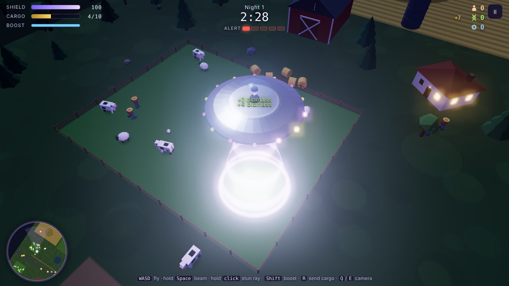

# Abduct & Conquer

A 3D browser game: you are **Commander Zix**, a gray alien. Abduct humans, cows and cars from the countryside, build an army on your mothership, then invade Earth and make humanity serve the Gray Empire.

## Play it

Double-click `index.html`. It opens in your browser (Chrome, Edge or Firefox). You need an internet connection the first time, because the 3D engine (three.js) loads from a CDN.

## How the game works

1. **Abduction nights.** Each night lasts 2:30 over a countryside with a town, three farms and an army base.
   - Hold the tractor beam over people, animals and vehicles to pull them into the saucer.
   - The cargo hold fills up. Send it to the mothership (`R`) before your shield breaks, or you lose what's inside.
   - Every abduction raises Earth's **alert level** (5 levels): police → soldiers in jeeps → tanks → missile trucks.
   - The stun ray never kills. Stunned people and disabled tanks are easy to beam up, and soldiers count as 2 humans.
2. **Mothership.** Spend what you collected:
   - Army units: Gray Clone, Hypno-Brute (a brainwashed human), Attack Saucer, Mega Walker.
   - Saucer upgrades: tractor beam (lift tanks at level 3), shield, engines, stun ray, cargo hold.
   - The war room compares your army with Earth's defenses. **Earth gets stronger every night you wait.**
3. **Invasion.** Your army lands in a city and fights on its own. Destroy the 3 shield pylons, then Earth's HQ. Fly support, zap defenders, beam up surrendering soldiers, and drop reinforcements with `1`–`4`.

Progress saves automatically in your browser.

## Controls

| Action | Keyboard + mouse | Touch |
|---|---|---|
| Fly | `W A S D` / arrows | left joystick |
| Tractor beam | hold `Space` | hold **Beam** |
| Stun ray | hold left mouse (aims at the cursor) | hold **Zap** (auto-aims) |
| Boost | `Shift` | **Boost** |
| Send cargo up | `R` | **Send** |
| Camera | `Q` / `E` turn, mouse wheel zoom | |
| Reinforcements (invasion) | `1` `2` `3` `4` | buttons on screen |
| Pause / mute | `P` or `Esc` / `M` | `II` button |

## Change the game (good first edits)

Everything is in `index.html`. The game balance lives near the top of the script, under the `1. BALANCE TABLES` banner:

- `CFG.nightLength`: seconds per night (150).
- `STAT`: saucer stats per upgrade level (beam lift, shield, speed, ray damage, cargo).
- `UPGRADES`: upgrade names and costs.
- `UNIT_TYPES`: army units (cost, HP, damage, speed, range).
- `LOOT`: what each thing is worth and how heavy it is (a cow is 2.5 tonnes and gives 4 biomass).
- `earthForces(L)`: how many soldiers, tanks and turrets defend Earth at defense level `L`.

Save the file and refresh the browser to see your change.

**Cheats for testing:** open the browser console (`F12`) and type `__AC.give(100)` to add 100 of every resource.

## How the code is organized

The script has 14 numbered sections (search for the `====` banners):

1. Balance tables · 2. Helpers + save system · 3. Sound (synthesized, no audio files) · 4. Renderer, lights, bloom · 5. Model kit + models (everything is built from boxes, cylinders and spheres) · 6. Effects (bolts, sparks, explosions, floating text, beam) · 7. Input · 8. HUD + menus · 9. Entities + AI · 10. The player's saucer · 11. Worlds (countryside, city, space) · 12. Invasion battle · 13. Game modes · 14. Main loop

Some ideas for what to add next:

- A new army unit: add it to `UNIT_TYPES` and give it a model in `spawnUnit`.
- A boss for the invasion, like a giant Earth robot guarding the HQ.
- More maps: a desert base, a big city at day, the Moon.
- Real sound effects or music files instead of the synthesized ones.
- Porting it to Godot or Unity later: the design and balance tables carry over directly.
